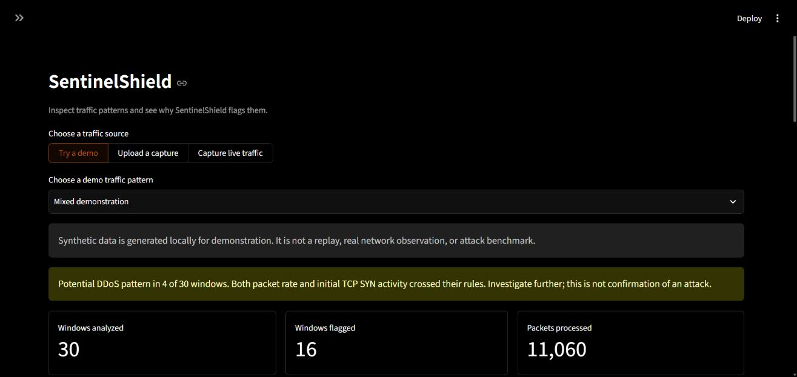

# SentinelShield

SentinelShield is a local DDoS traffic monitoring prototype built for a computer networks course project. It reads packet captures or a short, explicitly started live capture, groups packet metadata into time windows, and explains why a window was flagged. It also has a synthetic demonstration that works without a network interface or dataset download.



The dashboard shows investigation signals. It does not confirm that an attack occurred or change firewall rules.

## Run the dashboard

Use Python 3.12, 3.13, or 3.14. In PowerShell, from the repository folder:

```powershell
python -m venv .venv
.\.venv\Scripts\python.exe -m pip install -e .
.\.venv\Scripts\python.exe -m streamlit run sentinelshield/dashboard/app.py
```

Open the local URL printed by Streamlit, usually `http://localhost:8501`. Leave **Try a demo** selected and switch between **Normal only**, **Mixed demonstration**, and **SYN-heavy windows**. The message, chart, and window decisions update automatically. [Start here](START_HERE.md) explains what each label means.

The other input modes are an authorized PCAP/PCAPNG upload and a bounded live capture. Live capture requires an explicit checkbox and button click. On Windows it may require Npcap and suitable interface permissions. Start with a small capture file because the upload is held in memory.

## How it works

1. Scapy extracts timestamps, addresses, ports, protocol, packet length, and TCP flags. Packet payloads are not stored in the project database.
2. Packets are grouped into five-second windows. Each window has 21 numeric features, including packet rate, byte rate, SYN activity, and traffic spread.
3. Explainable rules compare packet rate with a rolling median and median absolute deviation baseline. A separate rule checks initial TCP SYN ratio and rate.
4. The dashboard shows charts and rule reasons. SQLite stores aggregate windows, alerts, and expiring **simulated** block entries.

The four possible rule labels are `Normal`, `Unusual Traffic`, `Suspicious TCP SYN Pattern`, and `Potential DDoS Activity`. The thresholds are starting values, not validated attack cutoffs. See [feature definitions](docs/FEATURES.md) and [detection rules](docs/DETECTION.md).

## What the data shows so far

The project has a Random Forest training path, but the dashboard's optional ML comparison uses generated examples. Its synthetic score checks that training and inference work; it does not measure real attack detection.

We also trained separate models on CICFlowMeter flow CSVs and evaluated them on other datasets:

| Training data | Evaluation data | Measured result |
| --- | --- | --- |
| Supplied CIC-DDoS2019 flow CSV | Friday CIC-IDS2017 flow CSV | 36.4% DDoS recall; 24.8% benign false-alarm rate |
| 2019 and 2017 flow CSVs | Separate 2018 flow CSV | 26 of 687,742 DDoS flows detected; 0.0038% recall |

Those flow features differ from the dashboard's packet-window features, and the external results are too weak for live use. The five available LUCID PCAP excerpts have only one benign capture, so they cannot support an independent packet-window holdout score. The next research step is to collect more independently labeled captures and evaluate whole captures that were kept out of training. Full methods, counts, exclusions, and limitations are in [ML evaluation](docs/ML_EVALUATION.md) and the JSON files in [`results/`](results/).

## Files in this repository

| Path | Contents |
| --- | --- |
| [`sentinelshield/`](sentinelshield/) | Collection, processing, detection, evaluation, storage, and dashboard code |
| [`tests/`](tests/) | Unit tests for the main components |
| [`docs/`](docs/) | Feature, dataset, evaluation, live capture, and demonstration notes |
| [`results/`](results/) | Small audit and evaluation reports with measured values |
| [`report/SentinelShield_Project_Report_Repository_Copy.docx`](report/SentinelShield_Project_Report_Repository_Copy.docx) | Unsigned report copy with student IDs and signature images removed |
| [`presentation/SentinelShield_Project_Presentation_Final.pptx`](presentation/SentinelShield_Project_Presentation_Final.pptx) | Project presentation |

Large raw captures, dataset CSVs, trained model files, runtime databases, and report build files are kept out of Git. They are not needed for the synthetic dashboard demonstration. [Dataset preparation](docs/DATASET_PREPARATION.md) records the local data workflow; [the review brief](docs/REVIEW_BRIEF.md) gives a five-minute walkthrough.

**Current status:** the monitoring and demonstration pipeline works. Independent real-data validation of the packet-window detector is still needed before making a deployment or protection claim.
